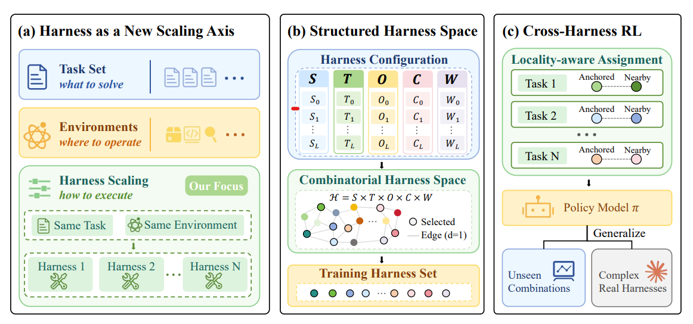
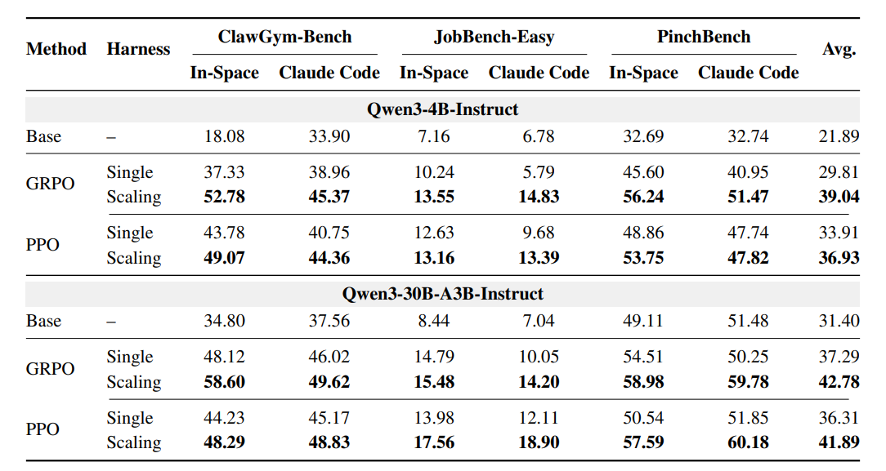
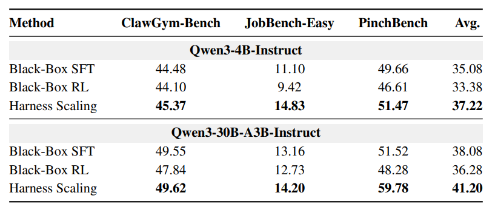
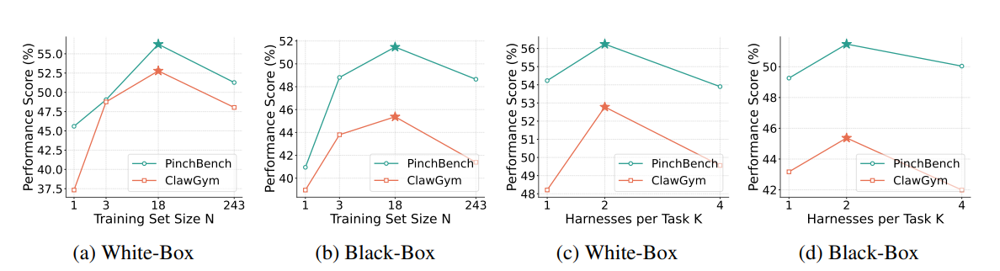
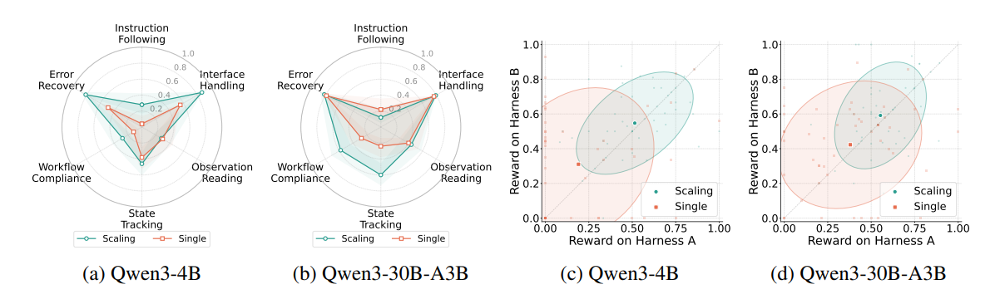

<h1 align="center">Harness Scaling for Generalizable Agentic Reinforcement Learning</h1>

<div align="center">
<a href="https://huggingface.co/papers/2610.29458"></a>
<a href="https://arxiv.org/abs/2610.29458" target="_blank"></a>
</div>

**Harness Scaling** introduces **a new scaling dimension for agentic reinforcement learning: how agents execute tasks across diverse harnesses**. By training across structured execution configurations, it improves generalization to unseen harness combinations and real-world black-box agent systems. 🚀

<h5 align="center">If you find our work useful, please give this repository a star ⭐.</h5>

## 💡 Overview

Modern agents rely on **harnesses** to organize instructions, expose tools, present observations, manage context, and coordinate multi-step workflows. However, agentic reinforcement learning (RL) typically optimizes a model through **one fixed harness**, potentially encouraging specialization to its particular interfaces and execution rules.

Can an agent learn **generalizable execution capabilities** instead of merely adapting to a single harness?

While **Task Scaling** expands *what to solve* and **Environment Scaling** expands *where to operate*, **Harness Scaling** studies a complementary dimension: **how to execute**. We systematically vary the harness while preserving the underlying task and environment, allowing a policy to learn from diverse forms of interaction.

<p align="center">
  
</p>

Our approach combines three key designs:

- **Structured harness space:** Factorize execution configurations into five components to model harness diversity systematically.
- **Balanced configuration selection:** Select a compact set of representative configurations with balanced component and pairwise coverage.
- **Cross-harness RL:** Train on the same task under structurally nearby harnesses, combining global diversity with controlled local variation.

Unlike methods that search for or evolve a better harness, **Harness Scaling focuses on training a policy that works effectively across different harnesses**.

## 🧩 Structured Harness Space

We represent each harness through five configurable components:

- **System Prompt (S):** How instructions and behavioral requirements are expressed.
- **Tool Interface (T):** How tools, names, parameters, and schemas are exposed.
- **Observation (O):** How tool results and environmental feedback are presented.
- **Context Management (C):** How interaction history is retained or compressed.
- **Workflow (W):** How planning, checking, and execution procedures are organized.

With **three realizations for each component**, the factorized space contains **3⁵ = 243 harness configurations**. We measure structural proximity using **Hamming distance**, which counts the components on which two configurations differ.

This controlled space enables two complementary generalization tests: **unseen combinations** within the factorized space and **unseen external black-box harnesses** beyond it.

## 🎯 Structured Harness Selection

More harness configurations do not necessarily lead to stronger learning under a fixed training budget. Exhaustively covering the full space may spread optimization across redundant combinations.

We therefore use a **strength-2 orthogonal design** to select **18 training harnesses** from the 243 possible configurations, preserving:

- **Component balance:** Each realization of every component is represented evenly.
- **Pairwise combination balance:** Realization pairs across any two components occur equally often.

The objective is not simply to maximize harness diversity, but to **organize that diversity into an effective training distribution**.

## 🔁 Cross-Harness Reinforcement Learning

After selecting the training configurations, we use **locality-aware task assignment** to determine how tasks are distributed across harnesses.

For each task, we randomly sample an **anchor harness** and assign its nearest configurations according to Hamming distance. In the main experiments, **K = 2**, so each task is trained under two related but distinct harnesses over successive optimization steps.

Random anchors provide **global coverage** across the training set, while nearby configurations provide **controlled local variation** for the same task. Harness Scaling changes the organization of task–harness experiences rather than requiring a new RL objective, and is compatible with both **GRPO** and **PPO**.

## 📊 Main Results

We train **Qwen3-4B-Instruct** and **Qwen3-30B-A3B-Instruct** on **13.5K ClawGym-Task instances**, and evaluate on **ClawGym-Bench**, **PinchBench**, and **JobBench-Easy**. Evaluation covers **18 held-out white-box configurations** and external black-box harnesses, including **Claude Code** and **OpenClaw**.

### Generalization to Unseen Harness Configurations

Harness Scaling consistently outperforms single-harness RL across model sizes and optimization algorithms. The following table reports **Pass@1** on three benchmarks under two evaluation settings (held-out configurations and Claude Code), together with the overall average.

<p align="center">
  
</p>

### White-Box Training Transfers to Black-Box Harnesses

A key finding is that **structured white-box harness training transfers effectively to complex external black-box systems**. On unseen **Claude Code**, Harness Scaling outperforms both supervised fine-tuning and RL performed directly through **OpenClaw** as the black-box training harness.

<p align="center">
  
</p>

*Average Pass@1 over ClawGym-Bench, JobBench-Easy, and PinchBench, evaluated through Claude Code.* Additional OpenClaw evaluations show a consistent transfer trend.

### The Organization of Harness Diversity Matters

Under a matched training budget, the **structured 18-harness set** outperforms a randomly selected set of the same size. It also outperforms training across all 243 configurations in the fixed-budget comparison. **The full-space comparison includes the white-box evaluation configurations**, so it is a stress test rather than a held-out generalization result.

Assigning **two nearby harnesses per task** works better than using only one or increasing to four in the reported experiments. Locality-aware assignment also improves over random assignment.

<p align="center">
  
</p>

These results highlight that **effective Harness Scaling depends not only on how much diversity is introduced, but also on how it is selected and organized**.

## 🧠 Behavioral Analysis

Beyond task success, we analyze six execution-related capabilities: **instruction following, interface handling, observation reading, state tracking, workflow compliance, and error recovery**.

Harness Scaling particularly improves **state tracking, workflow compliance, and error recovery**. Performance also becomes more consistent when the same tasks are executed through substantially different unseen harness configurations.

<p align="center">
  
</p>

Importantly, for **Qwen3-30B-A3B-Instruct with GRPO** on ClawGym-Bench, these gains come with little change to the original training harness: **−0.19** points on the base harness, versus **+10.48** points on held-out white-box configurations and **+3.60** points on Claude Code.

## 📄 Citation

If you find our work useful, please consider citing:

```bibtex
@misc{bai2026harnessscalinggeneralizableagentic,
      title={Harness Scaling for Generalizable Agentic Reinforcement Learning}, 
      author={Fei Bai and Huatong Song and Chuan Hao and Ran Tao and Jian Yang and Bryan Dai and Wayne Xin Zhao and Ji-Rong Wen},
      year={2026},
      eprint={2610.29458},
      archivePrefix={arXiv},
      primaryClass={cs.LG},
      url={https://arxiv.org/abs/2610.29458}, 
}
```

## 📞 Contact

For questions or feedback, please contact [Fei Bai](mailto:feibai@ruc.edu.cn).
